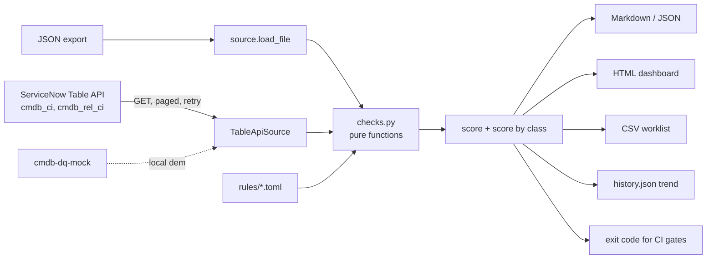

# snow-cmdb-data-quality

[](https://github.com/vagdevimsn-svg/snow-cmdb-data-quality/actions/workflows/ci.yml)
[](https://github.com/vagdevimsn-svg/snow-cmdb-data-quality/actions/workflows/quality.yml)


A CSDM-style health check for a ServiceNow CMDB. It reads CIs and relationships from the **Table API** (or a JSON export), scores data quality 0–100 overall and per CI class, and produces a **prioritized remediation worklist** — stale Discovery data, duplicate CIs, orphans, services with no dependencies or no business application, and retired CIs still in use.

> **Portfolio project.** Independently written by Vagdevi Meka with synthetic data. It contains no employer or client code or data.


## Business problem

Event Management, Service Mapping, Change risk and audit evidence all depend on the CMDB. When servers stop being discovered, duplicates slip past reconciliation, or an application service has nothing mapped beneath it, alerts bind to the wrong CI and change impact is guessed instead of calculated. Platform teams need a repeatable, scriptable way to measure CMDB health, show the trend, and hand each support group a concrete fix list.

## Features

- **9 checks across CSDM health dimensions** (completeness, correctness, compliance), each with severity and a remediation hint
- **Configurable rules** in TOML: thresholds, required fields per class, severities, on/off per check
- **Outputs:** Markdown, JSON, self-contained HTML dashboard, and a CSV worklist ready for an Import Set or task load
- **Score by class** (worst first) and **score history** with run-to-run delta for trending
- **Read-only Table API client:** pagination, retry with exponential backoff on 429/5xx (honours `Retry-After`), Basic auth or OAuth bearer token, https enforced
- **Mock Table API** (`cmdb-dq-mock`) so live mode runs end to end without an instance
- **CI gate:** `--fail-under 80` exits non-zero when health drops
- Packaged CLI (`cmdb-dq`), Dockerfile, docker-compose demo, scheduled GitHub Actions report, 32 tests, ruff, coverage gate

## Checks

| Check | Default severity | CSDM dimension | Rule |
|---|---|---|---|
| `missing_field` | medium | Completeness | Class-specific required fields (owner, support group, serial, IP, OS, criticality) |
| `never_discovered` | high | Correctness | Operational discoverable CI with no `last_discovered` |
| `stale` | medium | Correctness | Not discovered within `stale_days` (default 30) |
| `duplicate` | high | Correctness | Same serial (case-insensitive) or same name within a class |
| `dangling_relationship` | low | Correctness | Relationship points to a CI that does not exist |
| `orphan` | medium | Compliance | Operational CI with no `cmdb_rel_ci` relationship |
| `empty_service` | high | Compliance | Application service with no downstream CI |
| `service_without_business_app` | medium | Compliance | Application service not consumed by a `cmdb_ci_business_app` |
| `retired_in_use` | high | Compliance | Retired CI that an operational CI still depends on |

**Health score:** each CI loses weighted points per finding (high 3, medium 2, low 1), capped at 6 per CI so one broken record cannot hide the rest.

## Architecture



## Quick start

```bash
git clone https://github.com/vagdevimsn-svg/snow-cmdb-data-quality.git
cd snow-cmdb-data-quality
python -m venv .venv && source .venv/bin/activate
pip install -e ".[dev]"

cmdb-dq --input sample_data/cmdb_export.json                       # Markdown to stdout
cmdb-dq --input sample_data/cmdb_export.json --format html --output report.html
cmdb-dq --input sample_data/cmdb_export.json --format csv --output worklist.csv
cmdb-dq --input sample_data/cmdb_export.json --history history.json --fail-under 80
```

Sample outputs: [Markdown](docs/sample_report.md) · [HTML](docs/sample_report.html) · [CSV worklist](docs/remediation_worklist.csv)

### Live mode without an instance (mock Table API)

```bash
cmdb-dq-mock --port 8080 &                      # user demo / password demo
SN_INSTANCE_URL=http://127.0.0.1:8080 SN_USER=demo SN_PASSWORD=demo cmdb-dq --live
```

Or with Docker: `docker compose up --build --abort-on-container-exit --exit-code-from cmdb-dq`

### Against a personal developer instance (PDI)

```bash
cp .env.example .env          # instance URL + read-only user, or SN_TOKEN for OAuth
set -a; source .env; set +a
cmdb-dq --live --query "install_status=1" --format html --output report.html
```

### Custom rules

```bash
cp cmdb_dq/rules/default.toml my_rules.toml   # edit thresholds, required fields, severities
cmdb-dq --input sample_data/cmdb_export.json --rules my_rules.toml
```

## Tests and quality

```bash
make test     # pytest with coverage
make lint     # ruff
```

32 tests cover every check, rule loading and validation, scoring, all four report formats (including HTML escaping), CLI exit codes, history, Table API paging, retries, auth errors, unreachable hosts, and a full live run against the mock server. CI runs on Python 3.11–3.13, builds the Docker image and runs the compose demo.

## Security

See [SECURITY.md](SECURITY.md). GET-only, credentials from environment variables only, https enforced, synthetic sample data (`SYN-` serials, RFC 1918 addresses).

## Limitations and roadmap

- Duplicate detection is name/serial based; production reconciliation should rely on IRE identification rules.
- Reads base `cmdb_ci` fields; class-specific attributes need per-class queries.
- Next: full CSDM layer checks (technical service offerings, service offerings), a scoped app that writes findings back as remediation tasks, and trend charts in the HTML report.

## License

MIT — see [CHANGELOG.md](CHANGELOG.md) for release notes.
